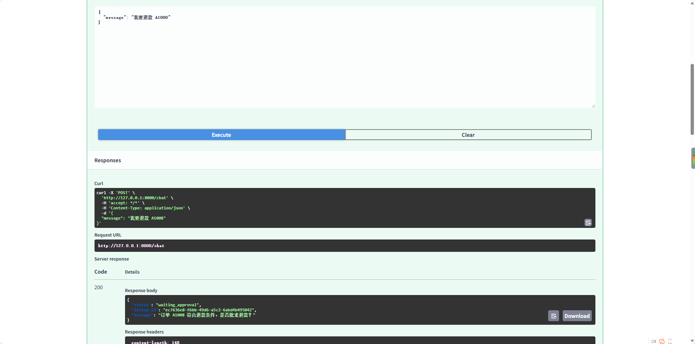
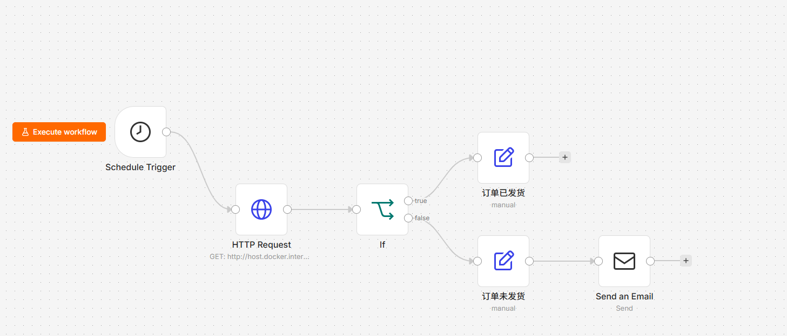
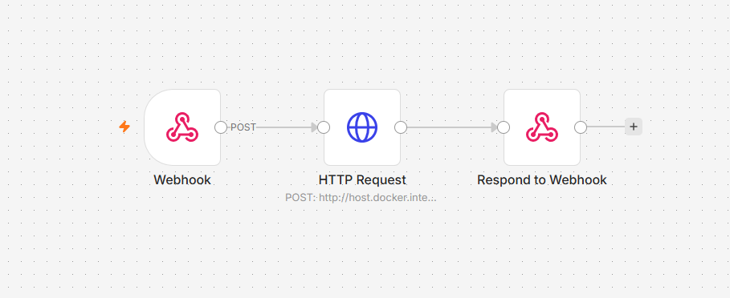

# AI Order Service

AI 智能订单客服与售后自动化系统。

该项目使用 FastAPI、PostgreSQL、LangGraph、MCP、RAG、n8n、pytest 和 Docker 构建，模拟电商客服与售后场景，实现自然语言订单查询、商品问答、退款审批、自动化通知等功能。

---

## 核心功能

- 自然语言查询订单状态
- 商品知识库 RAG 问答
- LLM 用户意图分类
- 退款资格自动检查
- Human-in-the-loop 人工退款审批
- LangGraph Checkpoint / Resume
- MCP Tool 调用
- n8n 定时订单状态检查
- n8n 邮件异常通知
- n8n Webhook 调用 AI 客服
- pytest 自动化测试
- Docker Compose 多服务部署
- 日志记录和全局异常处理

---

## 项目架构

```text
用户
 │
 ▼
FastAPI /chat
 │
 ▼
LangGraph
 │
 ▼
意图分类
 │
 ├──────────────┬──────────────┐
 ▼              ▼              ▼
Order          Refund         Product
 │              │              │
 ▼              ▼              ▼
MCP        check_refund       RAG
 │              │              │
 │              ▼              ▼
 │        Human Approval     Chroma
 │              │              │
 │        interrupt/resume     ▼
 │              │             LLM
 │              ▼
 └──────────► MCP Server
                │
                ▼
           PostgreSQL
```

---

## 技术栈

### Backend
- Python
- FastAPI
- Uvicorn
- Pydantic

### Database
- PostgreSQL
- SQLAlchemy

### AI
- LLM API
- Prompt Engineering
- Structured Output
- RAG
- Sentence Transformers
- Chroma
- BAAI/bge-small-zh-v1.5

### Agent
- LangGraph
- State / Node / Conditional Edge
- Checkpoint
- Human-in-the-loop
- `interrupt`
- `Command(resume)`

### MCP
- MCP Server
- MCP Client
- MCP Tool
- Streamable HTTP

### Automation
- n8n
- Schedule Trigger
- HTTP Request
- IF
- Webhook
- Respond to Webhook
- Email Send

### Testing
- pytest
- pytest-asyncio
- FastAPI TestClient
- monkeypatch
- 独立 SQLite 测试数据库

### Deployment
- Docker
- Docker Compose

---

## 项目目录

```text
ai_order_service/
│
├── agent/
│   ├── __init__.py
│   ├── state.py
│   ├── nodes.py
│   └── graph.py
│
├── knowledge/
│   └── product_faq.txt
│
├── mcp_app/
│   ├── __init__.py
│   ├── server.py
│   └── client.py
│
├── routes/
│   ├── __init__.py
│   ├── orders.py
│   ├── refunds.py
│   └── chat.py
│
├── services/
│   ├── __init__.py
│   ├── order_service.py
│   ├── refund_service.py
│   ├── llm_service.py
│   ├── intent_service.py
│   ├── message_service.py
│   └── rag_service.py
│
├── tests/
│   ├── __init__.py
│   ├── conftest.py
│   ├── test_order_service.py
│   ├── test_refund_service.py
│   ├── test_api.py
│   └── test_agent.py
│
├── main.py
├── database.py
├── models.py
├── schemas.py
├── logger.py
├── create_tables.py
├── seed.py
├── build_rag.py
├── Dockerfile
├── docker-compose.yml
├── requirements.txt
├── .env.example
├── .gitignore
└── README.md
```

---

## 环境变量

复制 `.env.example` 并创建 `.env`：

```env
DATABASE_URL=postgresql+psycopg://postgres:postgres@db:5432/ai_order_service

MCP_URL=http://mcp:8001/mcp

LLM_API_KEY=your_api_key_here

LLM_BASE_URL=your_llm_api_url_here

LLM_MODEL=your_model_name_here
```

> 不要把真实 `.env` 上传到 GitHub。

---

## Docker 启动

启动项目：

```bash
docker compose up --build
```

查看容器：

```bash
docker ps
```

正常应包含：

```text
ai_order_api
ai_order_mcp
ai_order_db
```

第一次启动后创建数据库表：

```bash
docker compose exec api python create_tables.py
```

插入模拟订单：

```bash
docker compose exec api python seed.py
```

---

## API 文档

启动后访问：

```text
http://127.0.0.1:8000/docs
```

---

## API 示例

### 查询订单

```http
GET /orders/A1001
```

返回示例：

```json
{
  "order_id": "A1001",
  "customer_name": "Alice",
  "product_name": "Ceramic Egg Coddler",
  "amount": 29.99,
  "status": "shipped",
  "paid": true
}
```

### AI Chat

```http
POST /chat
```

请求：

```json
{
  "message": "A1001 发货了吗？"
}
```

返回示例：

```json
{
  "status": "completed",
  "thread_id": "example-thread-id",
  "intent": "order",
  "answer": "订单 A1001 当前状态为 shipped。"
}
```

---

## RAG 商品问答

请求：

```json
{
  "message": "这个 Egg Coddler 容量是多少？"
}
```

流程：

```text
用户问题
↓
Intent = product
↓
LangGraph
↓
RAG
↓
Chroma
↓
Top-K Context
↓
LLM
↓
Answer
```

当知识库没有明确答案时，系统要求模型不要自行编造。

---

## 退款流程

请求：

```json
{
  "message": "我要退款 A1002"
}
```

系统会先检查：

```text
订单是否存在
是否已付款
是否已经发货
是否超过退款期限
```

符合条件后进入人工审批：

```text
check_refund
↓
approval
↓
interrupt
↓
等待人工决定
```

返回示例：

```json
{
  "status": "waiting_approval",
  "thread_id": "example-thread-id",
  "message": "订单 A1002 符合退款条件，是否批准退款？"
}
```

人工批准：

```http
POST /chat/resume
```

请求：

```json
{
  "thread_id": "example-thread-id",
  "approved": true
}
```

恢复执行：

```text
Checkpoint
↓
Command(resume=True)
↓
execute_refund
↓
MCP refund_order
↓
PostgreSQL
```

---

## MCP Tools

MCP Server 提供：

```text
get_order
check_refund
refund_order
```

调用链：

```text
LangGraph
↓
MCP Client
↓
MCP Server
↓
Tool
↓
Service
↓
PostgreSQL
```

---

## n8n 自动化

### 订单状态监控

```text
Schedule Trigger
↓
HTTP Request
↓
GET /orders/{order_id}
↓
IF
↓
异常订单
↓
Send Email
```

用于定时检查订单状态并自动发送提醒邮件。

### AI Webhook

```text
Webhook
↓
HTTP Request
↓
POST /chat
↓
Respond to Webhook
```

外部系统可以通过 n8n Webhook 调用 AI 客服。

---

## 自动化测试

运行：

```bash
pytest -v
```

测试覆盖：

```text
Order Service
Refund Service
FastAPI API
LangGraph Node
Intent Routing
Product Node
Refund Eligibility
interrupt
resume
```

Agent 测试使用 `monkeypatch` 替代真实 LLM 和 MCP 调用，减少网络和模型波动对测试结果的影响。

---

## 日志

日志文件：

```text
logs/app.log
```

记录内容包括：

```text
API 请求
Chat 请求
人工退款审批
退款成功
系统异常
```

---

## 项目亮点

- 使用 FastAPI 构建后端 API
- 使用 PostgreSQL + SQLAlchemy 管理订单和退款数据
- 使用 LLM 进行用户意图分类
- 使用 RAG 降低商品问答中的模型幻觉
- 使用 LangGraph 管理 Agent 工作流
- 使用 MCP 标准化订单和退款工具调用
- 使用 Human-in-the-loop 控制高风险退款操作
- 使用 Checkpoint + Resume 实现流程暂停与恢复
- 使用 n8n 完成定时任务、邮件通知和 Webhook 自动化
- 使用 pytest 对业务、API 和 Agent 流程进行自动化测试
- 使用 Docker Compose 部署 FastAPI、MCP Server 和 PostgreSQL
- 使用日志和全局异常处理提高项目可维护性

---

## 项目截图


### 1. FastAPI 接口文档

 ### 2. 订单查询结果

### 3. 退款处理结果


### 4. n8n 工作流



